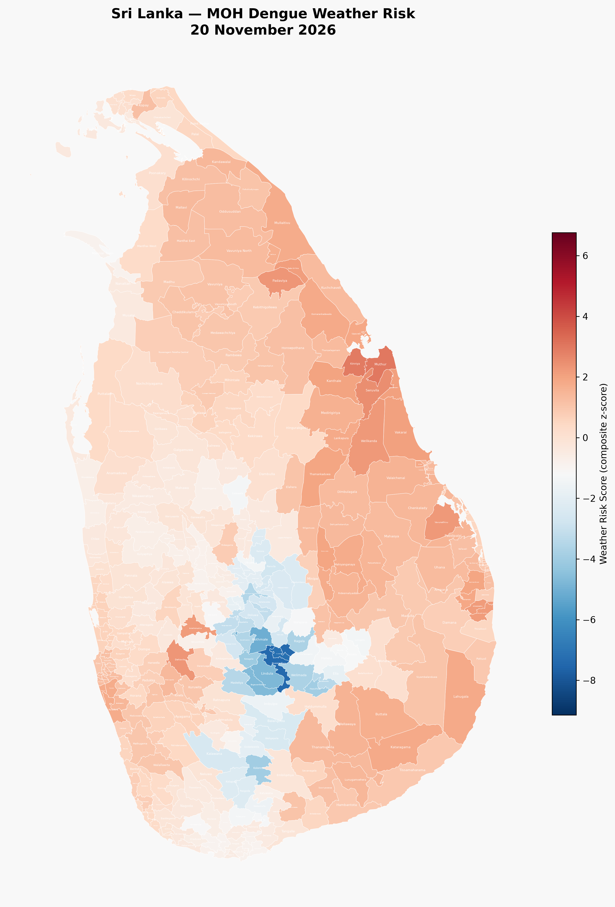
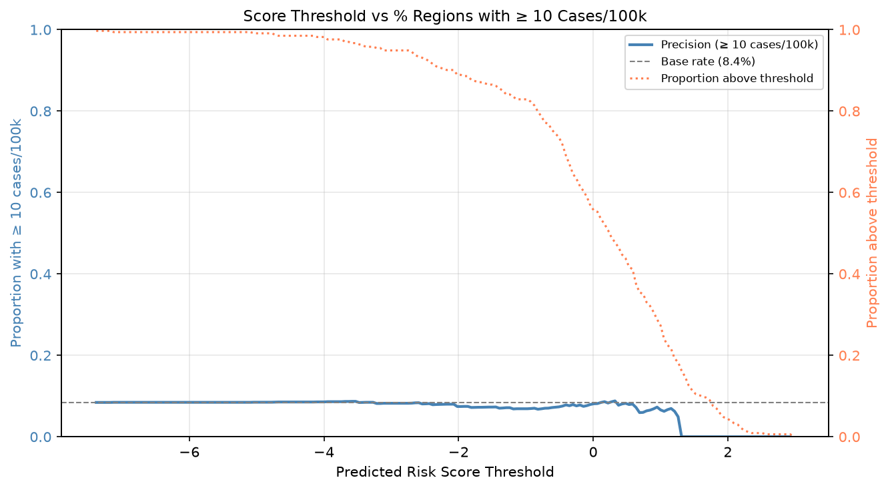
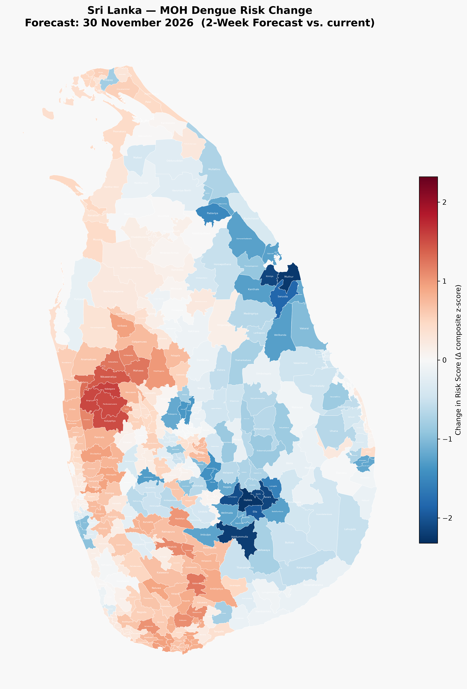
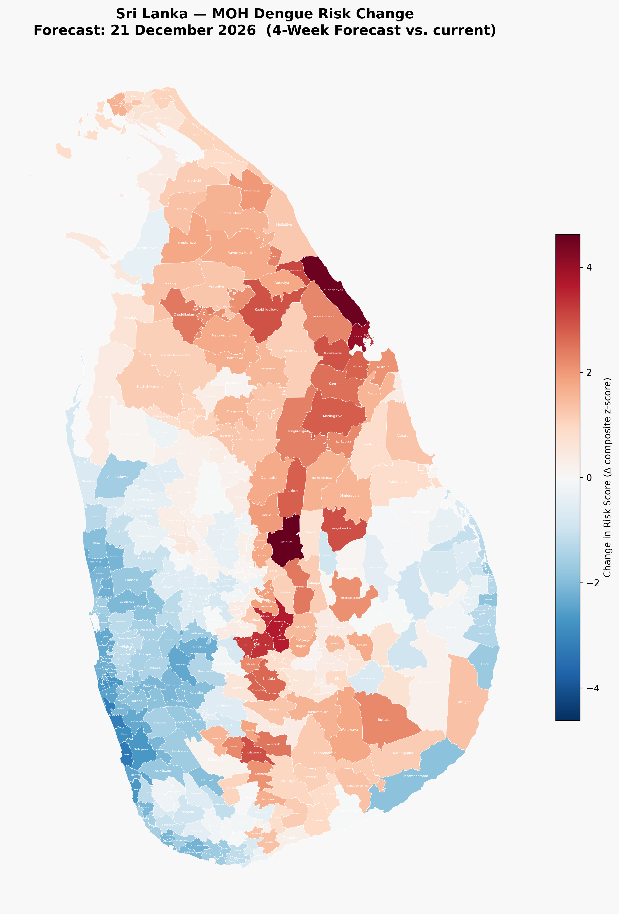

# lk_dengue_weather_model

Dengue outbreak weather-risk model for Sri Lanka MOH regions.

> 📖 **Methodology:** [README.methodology.md](README.methodology.md)

_Last updated: 25 November 2026 · 333 regions with model results._

---

## Risk Map

The choropleth below shows a composite weather-risk score for each MOH
region, derived from the three lagged predictors in Erandi et al. (2021):
weekly rainfall (lag 10 w), mean max temperature (lag 16 w), and mean
min temperature (lag 13 w). Higher scores (red) indicate conditions
associated with higher dengue risk.

---

## Top 20 High-Risk Regions

Sorted by composite weather-risk score (descending).

| Region | District | Risk Score | Rainfall mm (−10w) | Max Temp °C (−16w) | Min Temp °C (−13w) |
|---|---|---:|---:|---:|---:|
| Mahaoya | LK-52 | 2.53 | 66.7 | 34.9 | 27.3 |
| Padiyathalawa | LK-52 | 2.03 | 67.3 | 33.4 | 27.2 |
| Vavunathivu | LK-51 | 1.93 | 59.3 | 34.7 | 26.5 |
| Mahiyanganaya | LK-81 | 1.90 | 48.3 | 33.7 | 27.7 |
| Kopay | LK-41 | 1.82 | 65.8 | 32.5 | 27.4 |
| Girandurukotte | LK-81 | 1.80 | 49.4 | 34.3 | 27.0 |
| Chenkalady | LK-51 | 1.79 | 52.9 | 34.3 | 26.8 |
| Valaichenai | LK-51 | 1.73 | 40.0 | 34.2 | 27.5 |
| Batticaloa | LK-51 | 1.69 | 54.2 | 33.8 | 26.8 |
| Kiran | LK-51 | 1.68 | 39.1 | 33.8 | 27.7 |
| Ottamavadi | LK-51 | 1.63 | 38.6 | 33.7 | 27.6 |
| Koralaipattu ( Oddmavadi Central ) | LK-51 | 1.63 | 38.6 | 33.7 | 27.6 |
| Paddipalai | LK-51 | 1.62 | 64.5 | 34.5 | 25.6 |
| Welikanda | LK-72 | 1.56 | 54.3 | 33.2 | 26.9 |
| Mathugama | LK-13 | 1.53 | 167.7 | 28.2 | 23.8 |
| Dimbulagala | LK-72 | 1.51 | 36.0 | 33.8 | 27.4 |
| Eravur | LK-51 | 1.47 | 48.6 | 33.4 | 26.9 |
| Vakarai | LK-51 | 1.45 | 36.9 | 33.5 | 27.4 |
| Pitakotte | LK-11 | 1.41 | 126.0 | 28.5 | 25.7 |
| Rathmalana | LK-11 | 1.41 | 126.0 | 28.5 | 25.7 |

> **Note:** Risk scores are weather-only (composite z-score of lagged
> meteorological predictors). Full GLM-based dengue
> incidence prediction requires historical case data (not yet integrated).

---

## Model Validation

Composite weather-risk score vs reported cases/100k (333 regions with available case data).

| Metric | Value |
|---|---:|
| Pearson *r* | -0.008 |
| Spearman ρ | 0.0435 |
| *p*-value (Pearson) | 0.885 |
| Regions (*n*) | 333 |

### Top 10 False Positives (high predicted risk, low actual cases)

| Region | District | Risk Score | Cases/100k |
|---|---|---:|---:|
| Mahaoya | Ampara | 2.53 | 0.0 |
| Padiyathalawa | Ampara | 2.03 | 0.0 |
| Vavunathivu | Batticaloa | 1.93 | 0.0 |
| Mahiyanganaya | Badulla | 1.90 | 0.0 |
| Kopay | Jaffna | 1.82 | 0.0 |
| Girandurukotte | Badulla | 1.80 | 0.0 |
| Chenkalady | Batticaloa | 1.79 | 0.0 |
| Valaichenai | Batticaloa | 1.73 | 0.0 |
| Batticaloa | Batticaloa | 1.69 | 0.0 |
| Kiran | Batticaloa | 1.68 | 0.0 |

### Top 10 False Negatives (low predicted risk, high actual cases)

| Region | District | Risk Score | Cases/100k |
|---|---|---:|---:|
| Kundasale | Kandy | -1.89 | 34.0 |
| Udunuwara | Kandy | -2.15 | 21.2 |
| Menikhinna | Kandy | -2.07 | 20.8 |
| Pathadumbara | Kandy | -1.80 | 20.6 |
| Yatinuwara | Kandy | -1.23 | 20.2 |
| Kandy Four Gravets & Gangawata Korale | Kandy | -3.20 | 19.7 |
| Ukuwela | Matale | -1.47 | 19.4 |
| Dompe | Gampaha | 0.42 | 18.9 |
| Harispattuwa | Kandy | -1.76 | 15.7 |
| Badulla | Badulla | -2.74 | 13.2 |

---

## Score Threshold Analysis

Proportion of MOH regions with ≥ 10 actual cases/100k among all regions with predicted risk score above a given threshold.

False positive rate (FPR) and false negative rate (FNR) for classifying regions as high-risk (≥ 10 cases/100k) at each threshold.

ROC curve with AUC = 0.5099.

---

## Forward-Looking Forecasts

Dengue weather-risk scores projected 2 and 4 weeks ahead, using the same lagged meteorological predictors applied to already-recorded historical weather.  All three maps (current + forecasts) share an identical colour scale so regional risk levels are directly comparable.

### 2-Week Forecast (7 December 2026)

### 4-Week Forecast (21 December 2026)

### Change from Current — 2-Week Delta

Blue regions show a projected **decrease** in risk; red regions show a projected **increase**.

### Change from Current — 4-Week Delta

---

## Data Sources

- **Weather:** [Open-Meteo Historical Weather API](https://open-meteo.com/en/docs/historical-weather-api)
  (ERA5 / ERA5-Land reanalysis, 0.1°–0.25° resolution)
- **Region boundaries:** Ministry of Health Sri Lanka (333 MOH regions)
- **Model:** Erandi et al. (2021), *Int. J. Dynamical Systems and Differential Equations*, Vol. 11, Nos. 5/6, pp. 462–472.
