# lk_dengue_weather_model

Dengue outbreak weather-risk model for Sri Lanka MOH regions.

> 📖 **Methodology:** [README.methodology.md](README.methodology.md)

_Last updated: 14 November 2026 · 333 regions with model results._

---

## Risk Map

The choropleth below shows a composite weather-risk score for each MOH
region, derived from the three lagged predictors in Erandi et al. (2021):
weekly rainfall (lag 10 w), mean max temperature (lag 16 w), and mean
min temperature (lag 13 w). Higher scores (red) indicate conditions
associated with higher dengue risk.

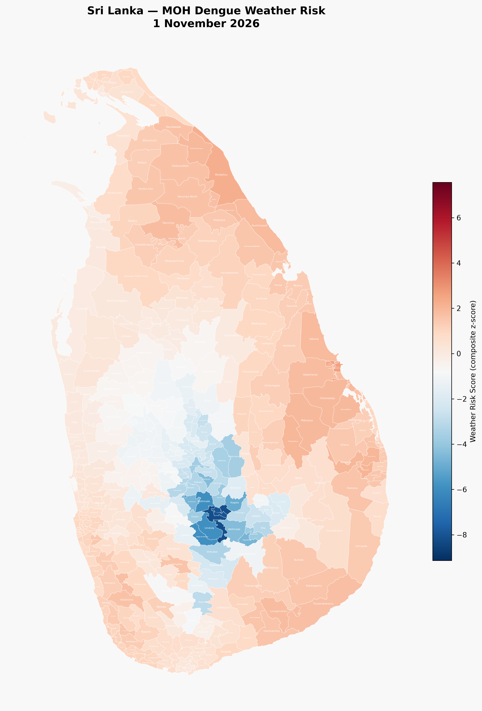

---

## Top 20 High-Risk Regions

Sorted by composite weather-risk score (descending).

| Region | District | Risk Score | Rainfall mm (−10w) | Max Temp °C (−16w) | Min Temp °C (−13w) |
|---|---|---:|---:|---:|---:|
| Trincomalee | LK-53 | 4.14 | 44.3 | 36.5 | 26.7 |
| Kuchchaveli | LK-53 | 4.06 | 41.3 | 36.7 | 26.8 |
| Eachchilampatru | LK-53 | 4.03 | 43.8 | 36.4 | 26.6 |
| Uppuveli | LK-53 | 3.97 | 42.2 | 36.5 | 26.6 |
| Muthur | LK-53 | 3.69 | 39.1 | 36.4 | 26.6 |
| Seruvila | LK-53 | 3.61 | 39.4 | 36.3 | 26.4 |
| Sammanthurai | LK-52 | 3.55 | 45.2 | 35.9 | 25.5 |
| Girandurukotte | LK-81 | 3.46 | 35.6 | 36.8 | 26.3 |
| Medirigiriya | LK-72 | 3.42 | 38.4 | 35.8 | 26.5 |
| Kinniya | LK-53 | 3.20 | 32.0 | 36.3 | 26.7 |
| Chenkalady | LK-51 | 3.17 | 34.2 | 36.1 | 26.4 |
| Vakarai | LK-51 | 3.15 | 28.0 | 36.4 | 27.2 |
| Welikanda | LK-72 | 3.13 | 30.9 | 36.1 | 26.9 |
| Kiran | LK-51 | 2.99 | 28.5 | 35.7 | 27.3 |
| Gomarankadawala | LK-53 | 2.98 | 30.9 | 36.3 | 26.4 |
| Valaichenai | LK-51 | 2.91 | 28.1 | 35.8 | 27.1 |
| Padiyathalawa | LK-52 | 2.88 | 30.0 | 36.4 | 26.2 |
| Mahiyanganaya | LK-81 | 2.86 | 26.1 | 36.8 | 26.5 |
| Lahugala | LK-52 | 2.85 | 27.8 | 37.0 | 26.0 |
| Thampalagamam | LK-53 | 2.84 | 31.9 | 35.8 | 26.2 |

> **Note:** Risk scores are weather-only (composite z-score of lagged
> meteorological predictors). Full GLM-based dengue
> incidence prediction requires historical case data (not yet integrated).

---

## Model Validation

Composite weather-risk score vs reported cases/100k (333 regions with available case data).

| Metric | Value |
|---|---:|
| Pearson *r* | -0.0951 |
| Spearman ρ | -0.1084 |
| *p*-value (Pearson) | 0.083 |
| Regions (*n*) | 333 |

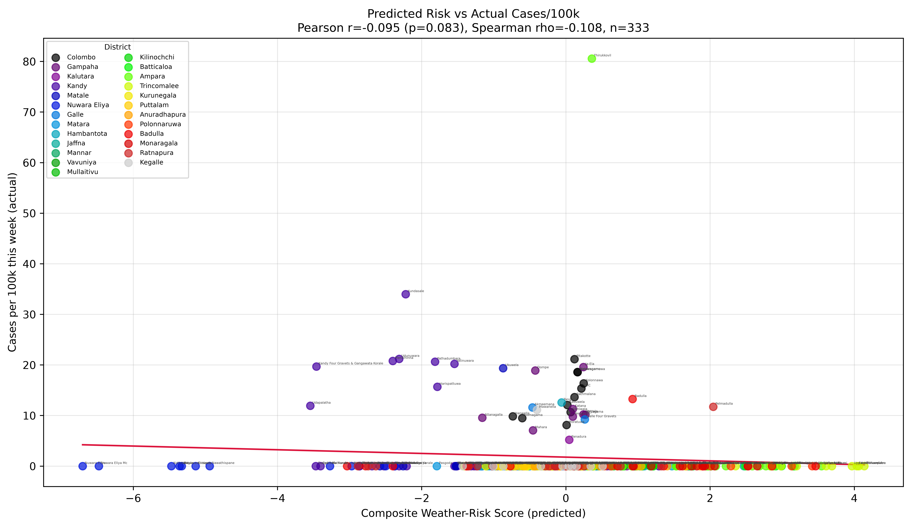

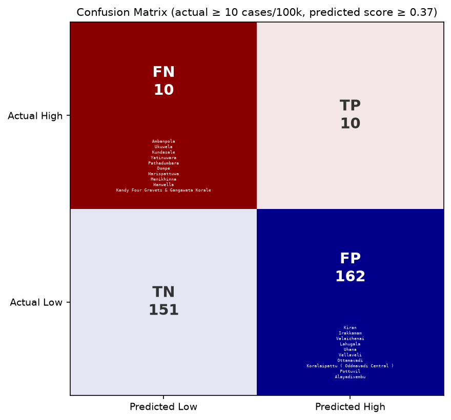

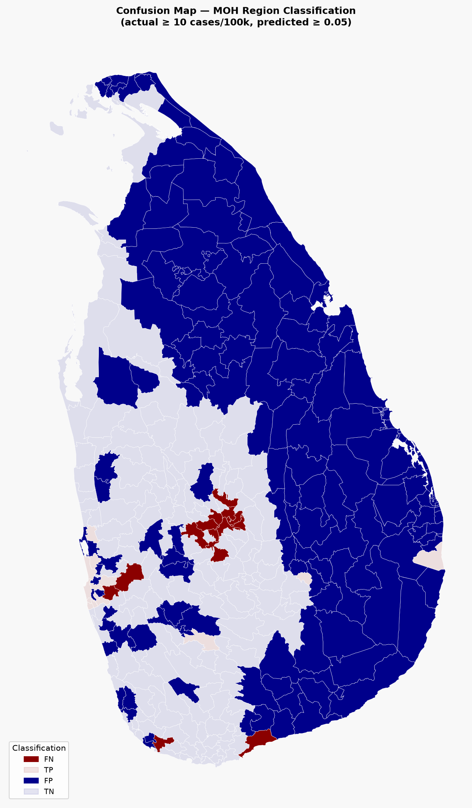

### Top 10 False Positives (high predicted risk, low actual cases)

| Region | District | Risk Score | Cases/100k |
|---|---|---:|---:|
| Trincomalee | Trincomalee | 4.14 | 0.0 |
| Kuchchaveli | Trincomalee | 4.06 | 0.0 |
| Eachchilampatru | Trincomalee | 4.03 | 0.0 |
| Uppuveli | Trincomalee | 3.97 | 0.0 |
| Muthur | Trincomalee | 3.69 | 0.0 |
| Seruvila | Trincomalee | 3.61 | 0.0 |
| Sammanthurai | Ampara | 3.55 | 0.0 |
| Girandurukotte | Badulla | 3.46 | 0.0 |
| Medirigiriya | Polonnaruwa | 3.42 | 0.0 |
| Kinniya | Trincomalee | 3.20 | 0.0 |

### Top 10 False Negatives (low predicted risk, high actual cases)

| Region | District | Risk Score | Cases/100k |
|---|---|---:|---:|
| Kundasale | Kandy | -2.22 | 34.0 |
| Udunuwara | Kandy | -2.31 | 21.2 |
| Menikhinna | Kandy | -2.40 | 20.8 |
| Pathadumbara | Kandy | -1.81 | 20.6 |
| Yatinuwara | Kandy | -1.55 | 20.2 |
| Kandy Four Gravets & Gangawata Korale | Kandy | -3.46 | 19.7 |
| Ukuwela | Matale | -0.87 | 19.4 |
| Dompe | Gampaha | -0.42 | 18.9 |
| Harispattuwa | Kandy | -1.78 | 15.7 |
| Tangalle | Hambantota | -0.06 | 12.6 |

---

## Score Threshold Analysis

Proportion of MOH regions with ≥ 10 actual cases/100k among all regions with predicted risk score above a given threshold.

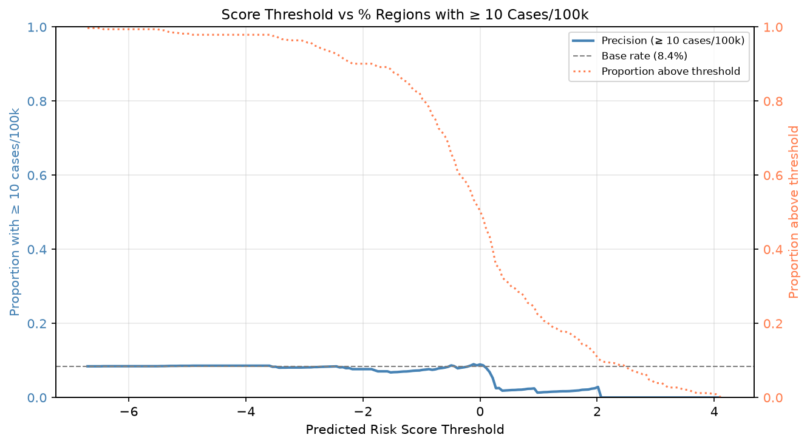

False positive rate (FPR) and false negative rate (FNR) for classifying regions as high-risk (≥ 10 cases/100k) at each threshold.

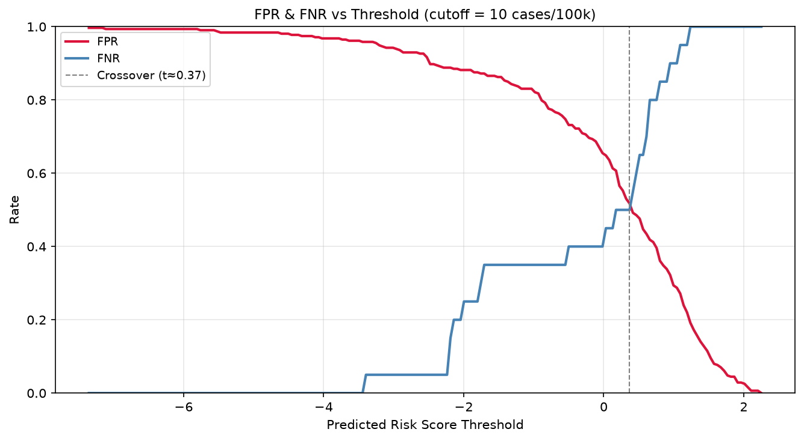

ROC curve with AUC = 0.409.

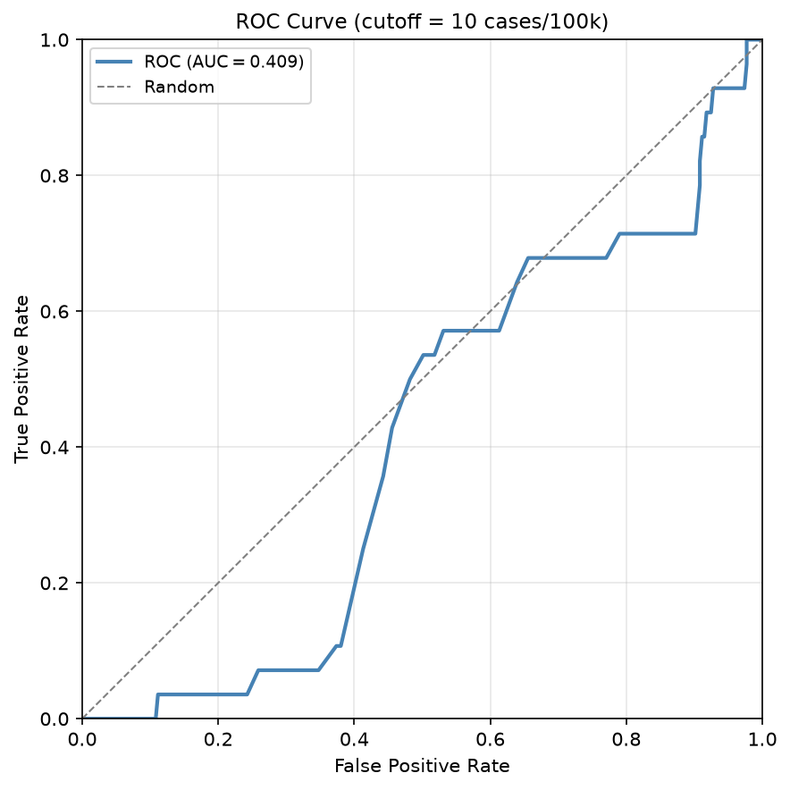

---

## Forward-Looking Forecasts

Dengue weather-risk scores projected 2 and 4 weeks ahead, using the same lagged meteorological predictors applied to already-recorded historical weather.  All three maps (current + forecasts) share an identical colour scale so regional risk levels are directly comparable.

### 2-Week Forecast (23 November 2026)

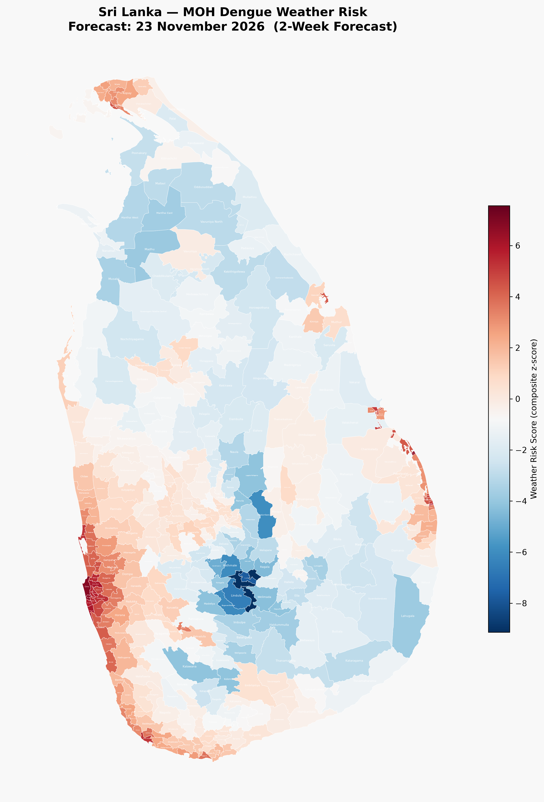

### 4-Week Forecast (7 December 2026)

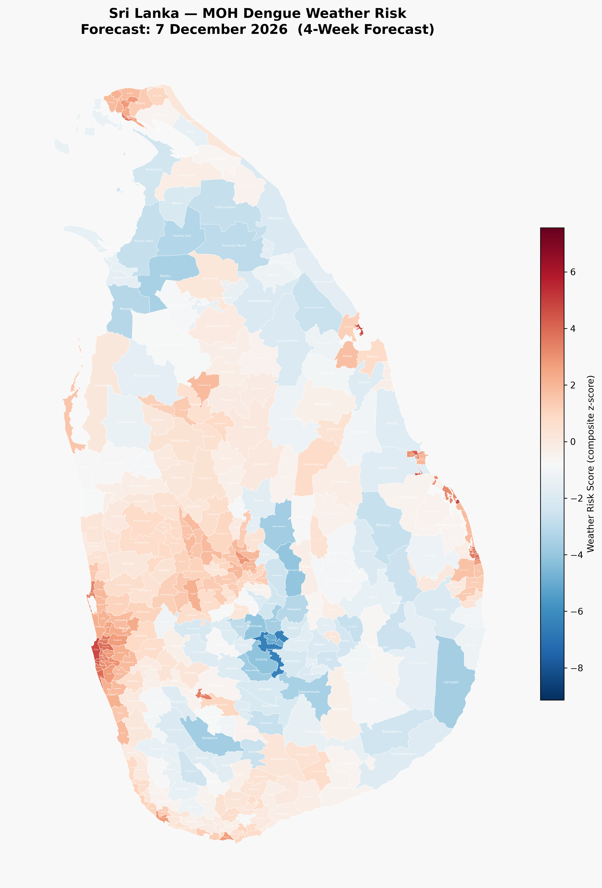

### Change from Current — 2-Week Delta

Blue regions show a projected **decrease** in risk; red regions show a projected **increase**.

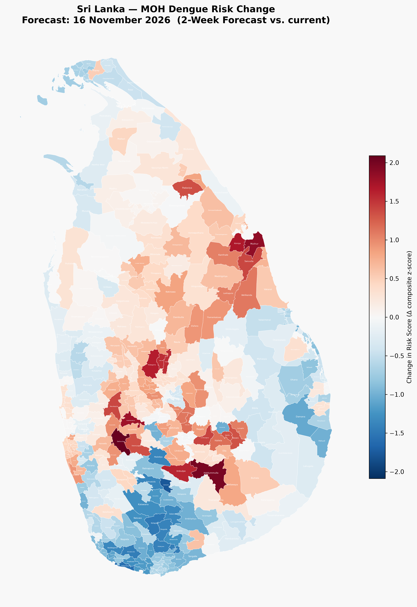

### Change from Current — 4-Week Delta

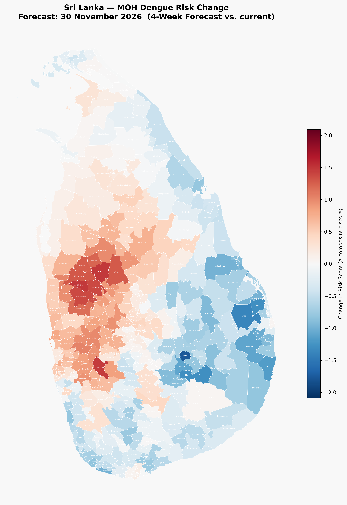

---

## Data Sources

- **Weather:** [Open-Meteo Historical Weather API](https://open-meteo.com/en/docs/historical-weather-api)
  (ERA5 / ERA5-Land reanalysis, 0.1°–0.25° resolution)
- **Region boundaries:** Ministry of Health Sri Lanka (333 MOH regions)
- **Model:** Erandi et al. (2021), *Int. J. Dynamical Systems and Differential Equations*, Vol. 11, Nos. 5/6, pp. 462–472.
