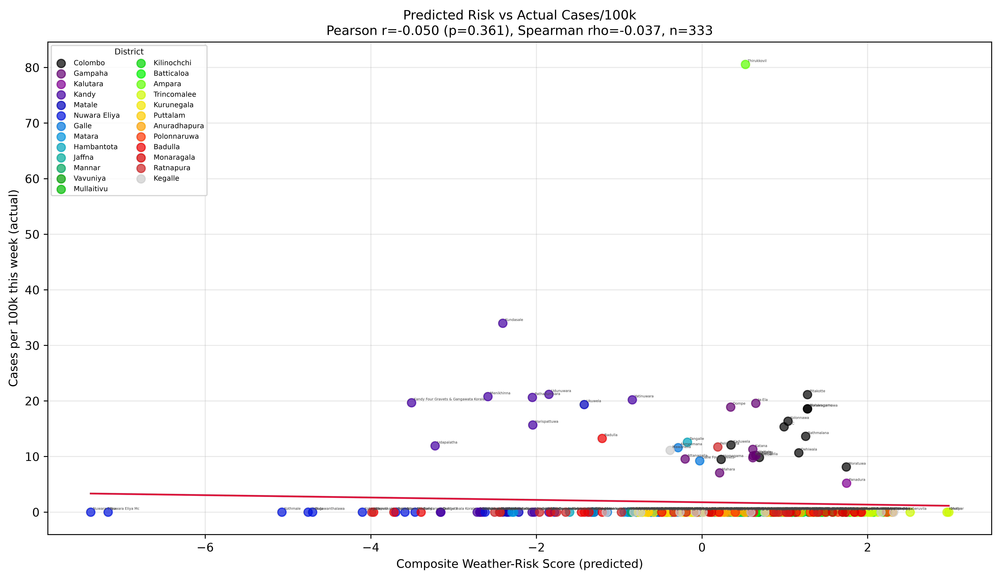
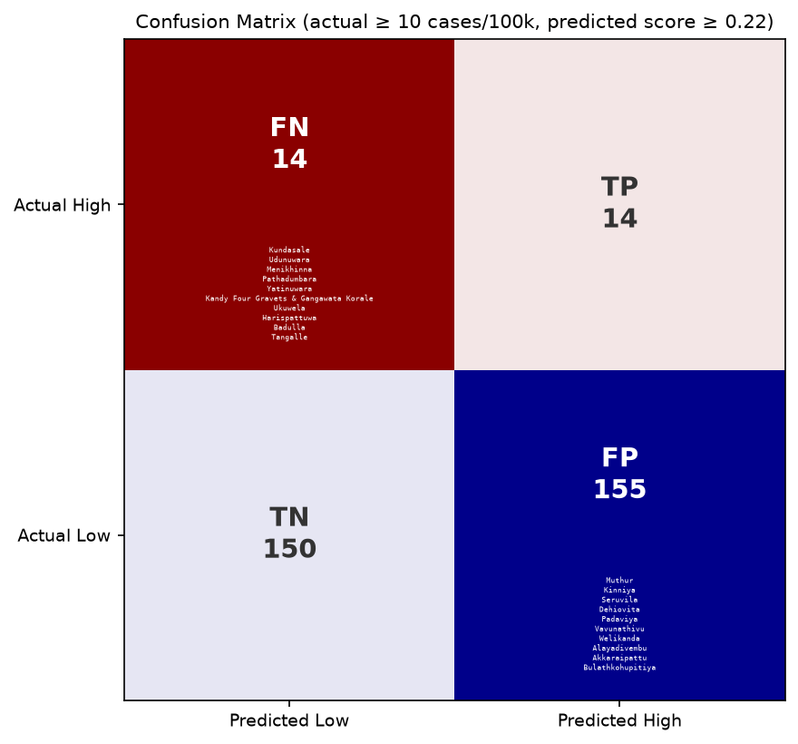
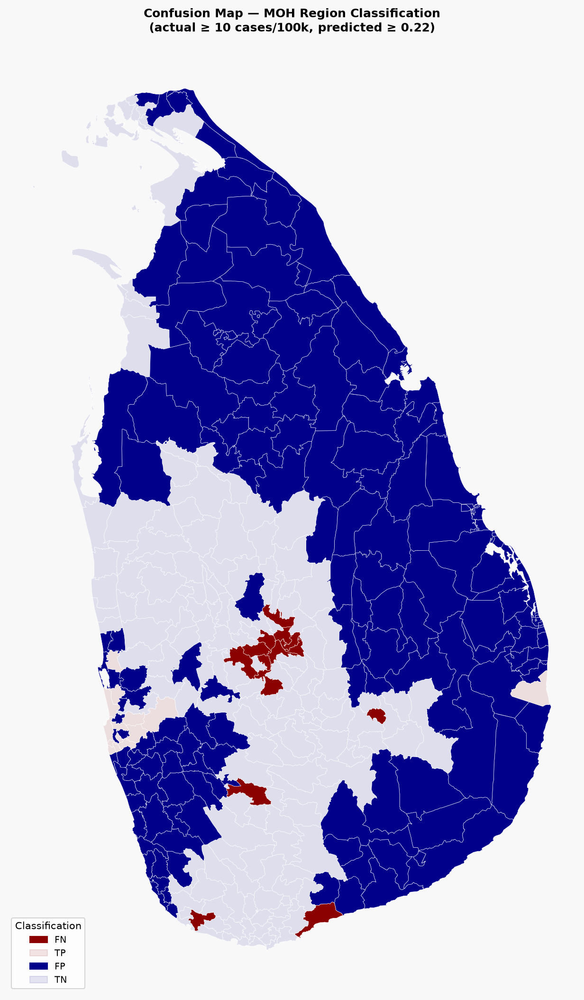
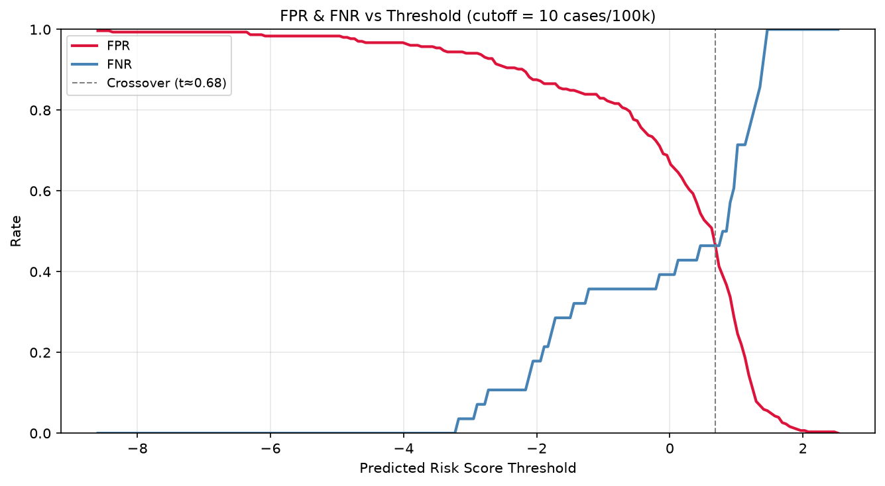
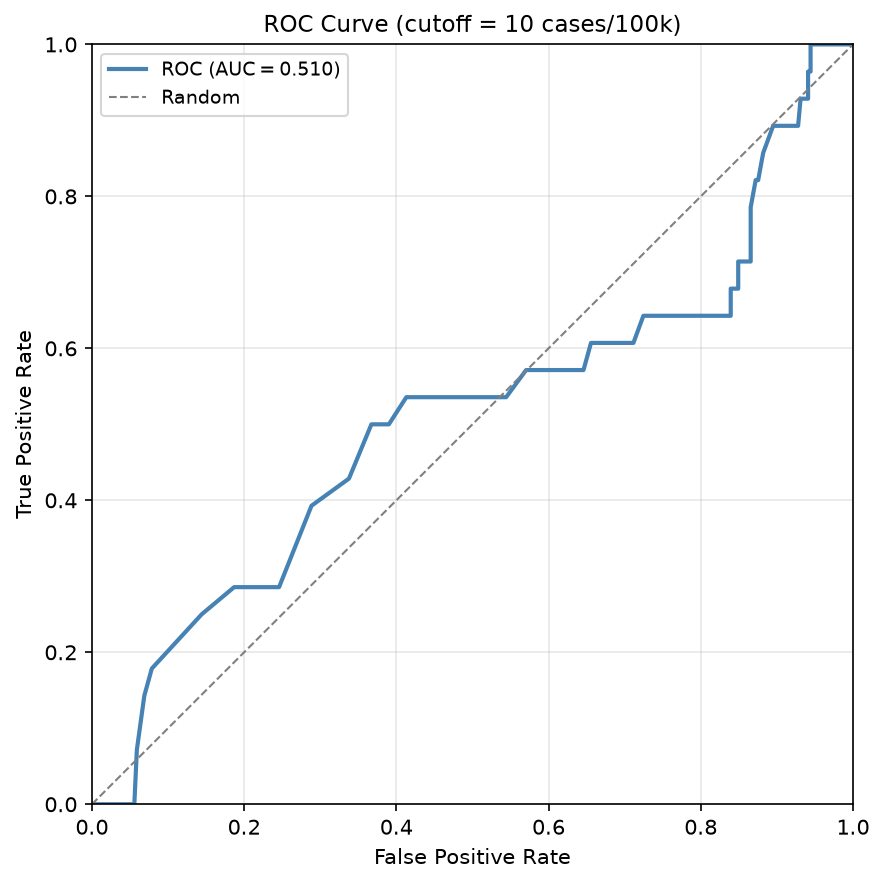
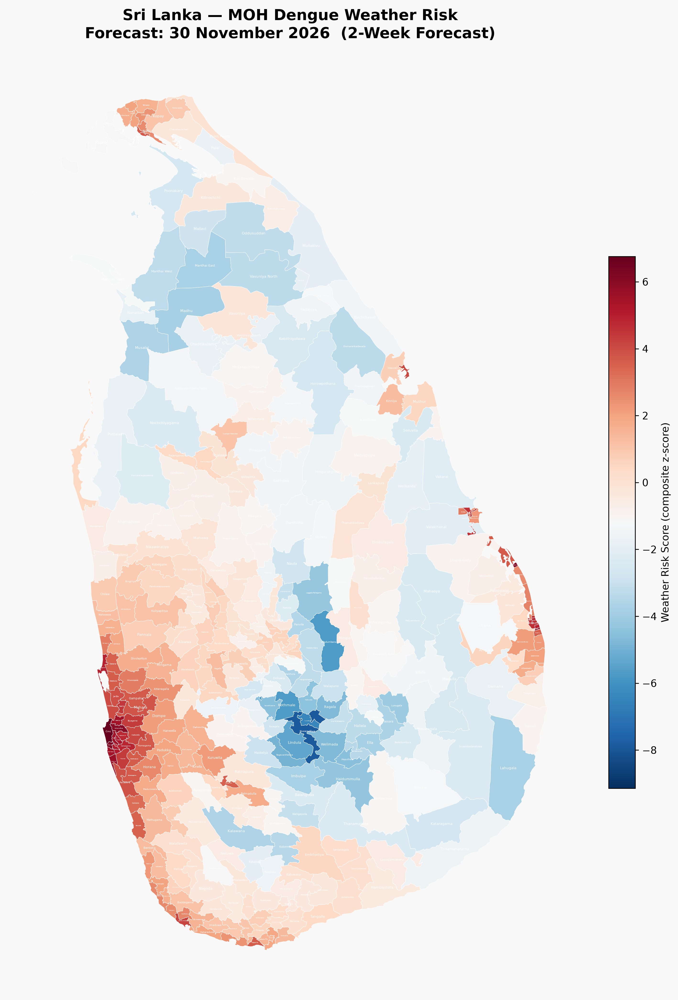
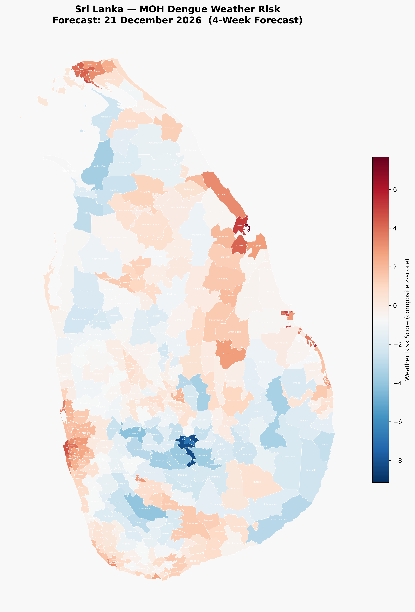

# lk_dengue_weather_model

Dengue outbreak weather-risk model for Sri Lanka MOH regions.

> 📖 **Methodology:** [README.methodology.md](README.methodology.md)

_Last updated: 17 November 2026 · 333 regions with model results._

---

## Risk Map

The choropleth below shows a composite weather-risk score for each MOH
region, derived from the three lagged predictors in Erandi et al. (2021):
weekly rainfall (lag 10 w), mean max temperature (lag 16 w), and mean
min temperature (lag 13 w). Higher scores (red) indicate conditions
associated with higher dengue risk.

---

## Top 20 High-Risk Regions

Sorted by composite weather-risk score (descending).

| Region | District | Risk Score | Rainfall mm (−10w) | Max Temp °C (−16w) | Min Temp °C (−13w) |
|---|---|---:|---:|---:|---:|
| Muthur | LK-53 | 2.98 | 43.6 | 35.9 | 26.6 |
| Kinniya | LK-53 | 2.96 | 43.4 | 35.7 | 26.6 |
| Seruvila | LK-53 | 2.51 | 36.5 | 35.8 | 26.4 |
| Dehiovita | LK-92 | 2.31 | 90.1 | 29.6 | 23.0 |
| Padaviya | LK-71 | 2.30 | 36.3 | 34.9 | 26.6 |
| Vavunathivu | LK-51 | 2.24 | 27.0 | 37.2 | 26.1 |
| Welikanda | LK-72 | 2.23 | 31.8 | 35.3 | 26.8 |
| Alayadivembu | LK-52 | 2.19 | 33.9 | 36.0 | 25.9 |
| Akkaraipattu | LK-52 | 2.19 | 33.9 | 36.0 | 25.9 |
| Bulathkohupitiya | LK-92 | 2.16 | 88.9 | 28.9 | 23.3 |
| Padavi Sri Pura | LK-53 | 2.12 | 28.4 | 35.7 | 26.7 |
| Vakarai | LK-51 | 2.07 | 22.7 | 35.9 | 27.2 |
| Eachchilampatru | LK-53 | 2.04 | 25.0 | 36.2 | 26.6 |
| Trincomalee | LK-53 | 2.03 | 25.0 | 36.1 | 26.6 |
| Kanthale | LK-53 | 2.00 | 31.2 | 35.5 | 26.1 |
| Sammanthurai | LK-52 | 1.95 | 26.0 | 37.5 | 25.3 |
| Thamankaduwa | LK-72 | 1.92 | 28.9 | 34.7 | 26.8 |
| Girandurukotte | LK-81 | 1.92 | 29.4 | 35.3 | 26.3 |
| Irakkamam | LK-52 | 1.91 | 26.9 | 36.5 | 25.8 |
| Kiran | LK-51 | 1.87 | 16.9 | 36.3 | 27.2 |

> **Note:** Risk scores are weather-only (composite z-score of lagged
> meteorological predictors). Full GLM-based dengue
> incidence prediction requires historical case data (not yet integrated).

---

## Model Validation

Composite weather-risk score vs reported cases/100k (333 regions with available case data).

| Metric | Value |
|---|---:|
| Pearson *r* | -0.0502 |
| Spearman ρ | -0.0366 |
| *p*-value (Pearson) | 0.361 |
| Regions (*n*) | 333 |

### Top 10 False Positives (high predicted risk, low actual cases)

| Region | District | Risk Score | Cases/100k |
|---|---|---:|---:|
| Muthur | Trincomalee | 2.98 | 0.0 |
| Kinniya | Trincomalee | 2.96 | 0.0 |
| Seruvila | Trincomalee | 2.51 | 0.0 |
| Dehiovita | Kegalle | 2.31 | 0.0 |
| Padaviya | Anuradhapura | 2.30 | 0.0 |
| Vavunathivu | Batticaloa | 2.24 | 0.0 |
| Welikanda | Polonnaruwa | 2.23 | 0.0 |
| Alayadivembu | Ampara | 2.19 | 0.0 |
| Akkaraipattu | Ampara | 2.19 | 0.0 |
| Bulathkohupitiya | Kegalle | 2.16 | 0.0 |

### Top 10 False Negatives (low predicted risk, high actual cases)

| Region | District | Risk Score | Cases/100k |
|---|---|---:|---:|
| Kundasale | Kandy | -2.41 | 34.0 |
| Udunuwara | Kandy | -1.85 | 21.2 |
| Menikhinna | Kandy | -2.59 | 20.8 |
| Pathadumbara | Kandy | -2.05 | 20.6 |
| Yatinuwara | Kandy | -0.84 | 20.2 |
| Kandy Four Gravets & Gangawata Korale | Kandy | -3.51 | 19.7 |
| Ukuwela | Matale | -1.42 | 19.4 |
| Harispattuwa | Kandy | -2.04 | 15.7 |
| Badulla | Badulla | -1.21 | 13.2 |
| Tangalle | Hambantota | -0.18 | 12.6 |

---

## Score Threshold Analysis

Proportion of MOH regions with ≥ 10 actual cases/100k among all regions with predicted risk score above a given threshold.

False positive rate (FPR) and false negative rate (FNR) for classifying regions as high-risk (≥ 10 cases/100k) at each threshold.

ROC curve with AUC = 0.4327.

---

## Forward-Looking Forecasts

Dengue weather-risk scores projected 2 and 4 weeks ahead, using the same lagged meteorological predictors applied to already-recorded historical weather.  All three maps (current + forecasts) share an identical colour scale so regional risk levels are directly comparable.

### 2-Week Forecast (30 November 2026)

### 4-Week Forecast (14 December 2026)

### Change from Current — 2-Week Delta

Blue regions show a projected **decrease** in risk; red regions show a projected **increase**.

### Change from Current — 4-Week Delta

---

## Data Sources

- **Weather:** [Open-Meteo Historical Weather API](https://open-meteo.com/en/docs/historical-weather-api)
  (ERA5 / ERA5-Land reanalysis, 0.1°–0.25° resolution)
- **Region boundaries:** Ministry of Health Sri Lanka (333 MOH regions)
- **Model:** Erandi et al. (2021), *Int. J. Dynamical Systems and Differential Equations*, Vol. 11, Nos. 5/6, pp. 462–472.
